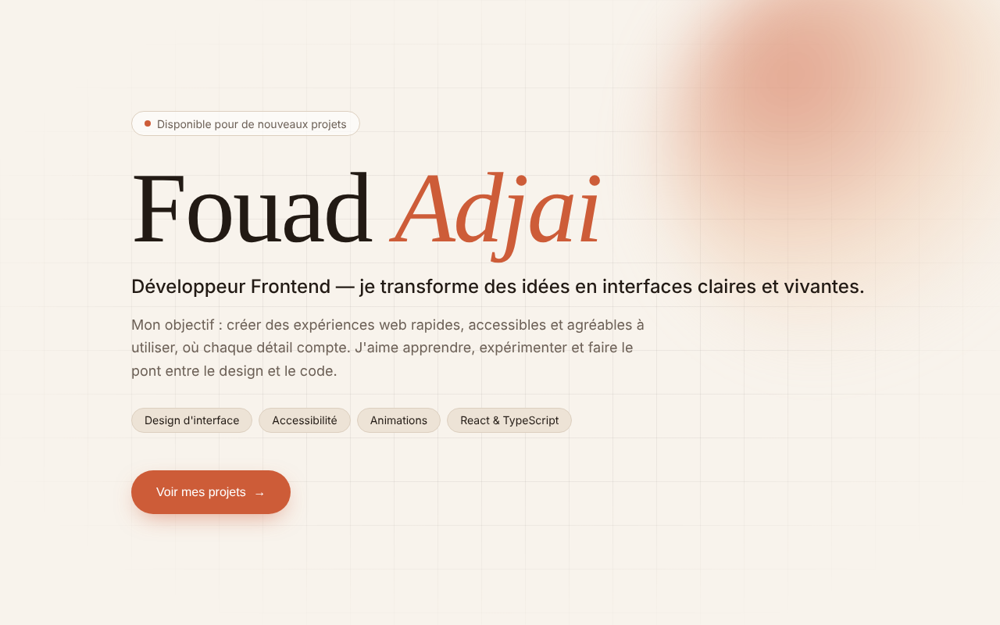

# Checkpoint : les bases du vibe coding avec l'IA

Une page de présentation personnelle (héros en une section) générée avec **Lovable**, puis exportée et retravaillée dans l'éditeur.

- **Fichier HTML exporté :** [`fouad-adjai.html`](fouad-adjai.html)
- **Contenu :** nom, sous-titre (développeur frontend), objectif, passions et bouton **« Voir mes projets »**.
- **Personnalisation dans Lovable :** thème de couleurs chaud (crème et terracotta), mise en page centrée, grille décorative en arrière-plan.

## Amélioration manuelle (après l'export)
- **Polices :** *Instrument Serif* pour le nom, *Manrope* pour le texte, avec un titre de taille fluide grâce à `clamp()`.
- **Espacements :** marges retravaillées entre le titre, le sous-titre et l'objectif, et padding réduit sur mobile (`@media (max-width: 640px)`).
- **Animations :** apparition progressive des éléments (`animation-delay`) et flèche du bouton qui se décale au survol.

## Capture d'écran

